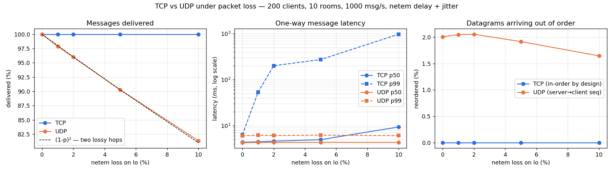
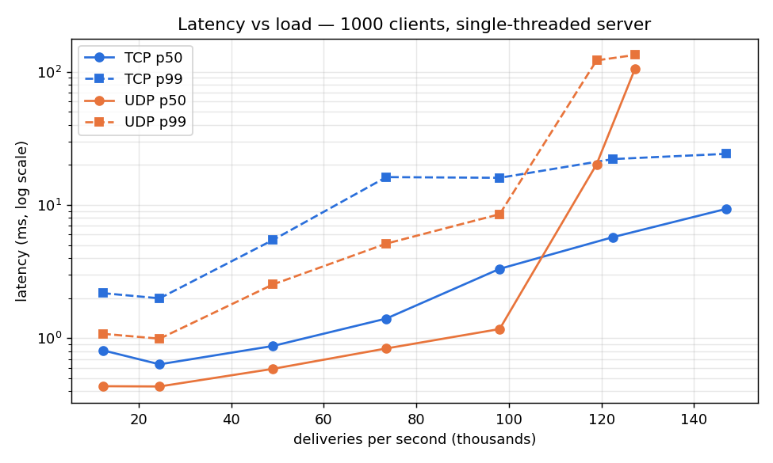

# Multi-Client Chat Server — TCP vs UDP Performance Study

An event-driven chat server in C: **one thread, epoll, non-blocking sockets**,
with chat rooms, private messages and presence tracking. A **length-prefixed
binary protocol** handles TCP framing. A UDP variant uses the same chat
logic, adds **sequence numbers**, and is compared against TCP under
**1–10% packet loss injected with `tc netem`**.

```
src/protocol.c     wire format: frame encode/parse, payload reader/writer, buffers
src/chat.c         transport-independent chat core: nicks, rooms, DMs, presence
src/hashmap.c      string-keyed hash map (nick → client, room → members)
src/server_tcp.c   epoll TCP server (framing, backpressure, write coalescing)
src/server_udp.c   epoll UDP server (per-peer sequence numbers, heartbeat timeouts)
src/client.c       interactive terminal client
src/loadtest.c     simulates N concurrent users; latency/throughput/loss/reordering
tests/integration_test.c   framing edge cases + end-to-end chat behaviour
scripts/run_netem.sh       TCP vs UDP loss sweep (0/1/2/5/10%)
scripts/run_capacity.sh    latency vs load, plus a 10,000-connection run
scripts/plot.py            graphs from the CSV results
```

## Build, test, run

Linux only (epoll, timerfd, tc). Needs `gcc`, `make`, `iproute2`; plots need
`python3-matplotlib`.

```bash
make            # builds bin/server_tcp bin/server_udp bin/client bin/loadtest ...
make test       # starts a server and runs the integration tests
make sanitize   # rebuild with AddressSanitizer + UBSan
```

Chat by hand in a few terminals:

```bash
bin/server_tcp -p 9000
bin/client -p 9000 alice      # then: /join lobby, hello!, /msg bob hi, /list, /ping, /quit
```

Load test and experiments:

```bash
bin/server_tcp -p 9000 &
bin/loadtest -P tcp -p 9000 -c 1000 -r 20 -R 1000 -d 10
scripts/run_netem.sh          # TCP vs UDP under loss  -> results/netem.csv
scripts/run_capacity.sh       # latency vs load        -> results/capacity.csv
python3 scripts/plot.py       # -> results/netem.png, results/capacity.png
```

The experiment scripts re-run themselves inside a private network namespace
(`unshare --user --net`), so `tc netem` needs **no sudo** and never touches
the host's real loopback interface.

## Protocol

TCP gives you a byte stream, not messages. One `recv()` may return half a
message, or several messages stuck together. Every TCP message is therefore
framed:

```
+-----------------+-----------+-----------------------------+
| length (u32 BE) | type (u8) | payload (length - 1 bytes)  |
+-----------------+-----------+-----------------------------+
```

The server keeps a **per-client input buffer**. After each read it loops:
are there 4 bytes for a length? Is the whole frame there? If so, handle it,
consume it, and repeat. A trailing partial frame stays buffered until more
bytes arrive. The length is **validated before waiting for the body**
(`1 ≤ length ≤ 64 KiB`), so a bogus prefix can't make the server buffer
gigabytes. The connection is dropped instead.

UDP preserves message boundaries, so a datagram is just
`type (u8) | seq (u32 BE) | payload`. The payload formats are identical
(strings are `u8 length + bytes`, integers big-endian). They are documented
in [`include/protocol.h`](include/protocol.h).

| Client → server | Server → client |
|---|---|
| `HELLO nick` | `WELCOME nick` |
| `JOIN room` / `LEAVE room` | `LIST room, count, nicks…` (also the join ack) |
| `ROOM room, msg_id, ts, body` | `ROOM room, from, msg_id, ts, body` |
| `PRIVATE to, msg_id, ts, body` | `PRIVATE from, msg_id, ts, body` |
| `LIST room` | `PRESENCE joined/left/offline, room, nick` |
| `PING ts` / `BYE` | `PONG ts` / `ERROR text` |

## Server design

**Single-threaded event loop.** One `epoll_wait` loop serves the listening
socket and every client. All sockets are non-blocking, so nothing can stall
the loop. There are no locks: all state belongs to one thread.

- **Accept:** `accept4(..., SOCK_NONBLOCK)` in a loop until `EAGAIN`, since
  several connections may be queued behind one readiness event.
- **Read:** one bounded `recv()` (64 KiB) per readiness event, then parse
  every complete frame. epoll is **level-triggered**: a socket with leftover
  data keeps reporting readiness, so reading a bounded chunk per event is
  safe, and one chatty client can't starve the rest. Edge-triggered mode
  would force reading until `EAGAIN` on every event and makes a missed drain
  a silent hang. Level-triggered gives the same performance here with fewer
  ways to get it wrong.
- **Write coalescing:** a room message fans out to every member. Frames are
  appended to each recipient's output queue and the recipient is marked
  dirty. After the whole event batch, each dirty socket is flushed with one
  `send()`, so many messages to one client cost one syscall.
- **Backpressure:** bytes the kernel won't accept stay queued, and `EPOLLOUT`
  is enabled until the queue drains. A client whose queue exceeds 4 MiB
  (it isn't reading) is disconnected, so one slow consumer can't exhaust
  server memory.
- **Deferred close:** a disconnect can be triggered in the middle of
  broadcasting to a room (a member's queue overflows). Freeing that client
  mid-iteration would be a use-after-free, so closes are queued and handled
  after the batch. Closing then broadcasts `OFFLINE` presence, which may
  dirty or close others, so the loop runs until both lists are empty.
- **Chat core is transport-independent.** `chat.c` knows nothing about
  sockets. Each server passes a `send` callback and embeds `client_t` as the
  first member of its own connection struct. TCP and UDP therefore share
  exactly the same room/DM/presence logic, which keeps the comparison fair.

**UDP variant.** There are no connections, so a client is identified by its
source `ip:port`. Because UDP never reports a disconnect, presence relies on
traffic: any datagram (PING works as a heartbeat) refreshes `last_seen`, and
a 1-second `timerfd` sweep marks clients silent for 10 s as offline. The
server numbers what it sends **per recipient**, so a client can tell
*missing* datagrams (seq never seen) from *late* ones (seq lower than one
already received). It tracks the client → server direction the same way.
Lost messages are deliberately **not** retransmitted: the point is to
measure raw UDP against TCP. Lost handshake messages (HELLO/JOIN) are
handled by the client retrying until the `LIST` ack arrives. That's why the
UDP server treats a repeated JOIN as idempotent.

## Load tester

`bin/loadtest` runs every simulated user in one epoll-driven process. Each
user has its own socket. Sender and receivers share `CLOCK_MONOTONIC`, so
one-way latency is just `receive_time − timestamp_in_message`.

- Client *i* joins room *i mod R*. Messages are sent at a fixed total rate
  from randomly chosen users (Poisson-like arrivals) and fanned out by the
  server to the sender's room-mates.
- **Delivery %** = unique deliveries / Σ(room size − 1) over sent messages.
- **Reordering (UDP)** = datagrams whose server sequence number is lower than
  one the recipient already has. TCP delivers each stream in order by design.
  The tester also checks per-sender order for both protocols.
- Output: p50/p95/p99/max latency, deliveries per second, loss and reordering,
  appended as a row to a CSV file.
- Loss is applied with `-S "tc qdisc add ... netem ..."`, which runs after
  every user has connected. The study therefore measures chat traffic under
  loss, not 1-second SYN retransmit stalls during connection setup.

## Results

Measured on a 6-core laptop under WSL2 (Linux 6.6), all on loopback. Every
number below comes from `results/*.csv`, produced by the scripts above.

### Tests

- `make test`: 32/32 checks pass. The checks cover a frame delivered one
  byte per `send()`, a JOIN plus 50 messages merged into a single `send()`
  (all 50 arrive intact and in order), zero and oversized length prefixes,
  rooms, private messages, duplicate nicknames, and JOINED / LEFT / OFFLINE
  presence.
- Both servers were also run under AddressSanitizer and UBSan, through the
  tests and a 300-client load test. No memory errors, no undefined behaviour,
  no leaks.

### TCP vs UDP under packet loss

`scripts/run_netem.sh`: 200 clients, 10 rooms (20 per room), 1,000 msg/s ⇒
~19,000 deliveries/s for 15 s per run. `netem delay 2ms ±1ms` on every run,
plus the loss shown.



| loss | proto | delivered | p50 ms | p95 ms | p99 ms | max ms | reordered |
|---|---|---|---|---|---|---|---|
| 0% | TCP | 100.00% | 4.4 | 5.8 | 6.3 | 12.5 | 0 (in-order) |
| 0% | UDP | 100.00% | 4.2 | 5.6 | 6.0 | 8.8 | 2.01% |
| 1% | TCP | 100.00% | 4.4 | 6.8 | 53.1 | 274.1 | 0 (in-order) |
| 1% | UDP | 97.86% | 4.3 | 5.7 | 6.2 | 68.6 | 2.05% |
| 2% | TCP | 100.00% | 4.6 | 16.0 | 201.2 | 721.0 | 0 (in-order) |
| 2% | UDP | 95.98% | 4.3 | 5.7 | 6.1 | 13.2 | 2.06% |
| 5% | TCP | 100.00% | 4.9 | 176.1 | 273.6 | 1008.6 | 0 (in-order) |
| 5% | UDP | 90.27% | 4.3 | 5.7 | 6.2 | 45.0 | 1.92% |
| 10% | TCP | 100.00% | 9.3 | 408.5 | 976.0 | 13910.3 | 0 (in-order) |
| 10% | UDP | 81.34% | 4.3 | 5.7 | 6.1 | 8.4 | 1.65% |

What this shows:

- **TCP converts loss into latency.** It always delivers 100%, in order, but
  a lost segment stalls everything queued behind it on that connection
  (head-of-line blocking) until it is retransmitted. Linux's minimum
  retransmission timeout is 200 ms, which is exactly where TCP's p99 lands
  at 2% loss. At 10% loss p99 reaches ~1 s, and repeated timeouts back off
  exponentially (max 13.9 s).
- **UDP converts loss into missing messages.** Its latency is flat at every
  loss rate (p99 ≈ 6 ms), but delivery falls as **(1 − p)²**. A chat
  message crosses the lossy interface twice (sender → server → receiver),
  and the measured delivery matches the prediction almost exactly
  (90.27% vs 90.25% at 5%; 81.34% vs 81.00% at 10%).
- **UDP reorders; TCP never does.** With 1 ms of jitter, ~2% of datagrams
  arrive after a later-numbered one. The receiver detects this from the
  server's per-recipient sequence numbers. TCP hides reordering (and loss)
  from the application entirely.
- In short: TCP suits chat, where every message must arrive in order and a
  rare 200 ms+ stall is acceptable. UDP suits data where stale is worthless
  (voice, game state), and the application must handle loss and ordering
  itself, using sequence numbers like these.

### Capacity: latency vs load

`scripts/run_capacity.sh`: 1,000 clients in 20 rooms (50 per room, so every
message is delivered to 49 people), no injected loss, 10 s per run.



| run | proto | clients | msg/s | deliveries/s | delivered | p50 ms | p99 ms |
|---|---|---|---|---|---|---|---|
| load250 | TCP | 1000 | 250 | 12,245 | 100.00% | 0.8 | 2.2 |
| load250 | UDP | 1000 | 250 | 12,244 | 100.00% | 0.4 | 1.1 |
| load1000 | TCP | 1000 | 1000 | 48,995 | 100.00% | 0.9 | 5.5 |
| load1000 | UDP | 1000 | 1000 | 48,989 | 100.00% | 0.6 | 2.5 |
| load2000 | TCP | 1000 | 2000 | 97,995 | 100.00% | 3.3 | 16.0 |
| load2000 | UDP | 1000 | 2000 | 97,995 | 100.00% | 1.2 | 8.5 |
| load2500 | TCP | 1000 | 2500 | 122,495 | 100.00% | 5.7 | 22.1 |
| load2500 | UDP | 1000 | 2500 | 118,952 | 97.11% | 20.2 | 121.5 |
| load3000 | TCP | 1000 | 3000 | 146,995 | 100.00% | 9.4 | 24.2 |
| load3000 | UDP | 1000 | 3000 | 127,214 | 86.54% | 104.4 | 133.4 |
| conc10000 | TCP | 10000 | 1000 | 8,998 | 100.00% | 0.3 | 1.0 |
| conc10000 | UDP | 10000 | 1000 | 8,998 | 100.00% | 0.2 | 0.5 |

(Full table, including 500 and 1,500 msg/s, is in `results/capacity.csv`.)

- **One thread handles 1,000 concurrent users at ~147,000 deliveries/s over
  TCP with zero loss**, and **10,000 concurrent connections** at sub-ms p99.
- **Below saturation UDP is faster** (about half TCP's latency): no ACKs,
  no per-connection state, smaller headers.
- **Under overload the two fail differently.** Past ~100k deliveries/s the
  single thread can't keep up. With TCP, flow control pushes back on the
  senders: data waits in socket buffers, latency rises gradually, and
  nothing is lost. UDP has no flow control, so the server's receive buffer
  (capped at 208 KB by `net.core.rmem_max`) overflows and the kernel drops
  incoming datagrams. The server's `uplink_gaps` counter shows the drops
  are all on the client → server side.
- **Where the time goes:** the server is CPU-bound in the kernel, not in
  application code. Each delivery is a `send()` through the loopback TCP
  stack. Write coalescing already merges multiple frames per recipient per
  loop iteration. The next steps would be `SO_REUSEPORT` with one event loop
  per core, or `sendmmsg()`/io_uring for batched UDP sends.

### Lessons from building it

- My first load tester sent every UDP heartbeat in one burst each second.
  The burst queued up in front of chat messages at the server, causing
  periodic latency spikes, and it overflowed the receive buffer during the
  10,000-client setup. With heartbeats spread evenly over each second,
  10,000-client UDP p99 dropped from 27 ms to 0.5 ms.
- Measuring reordering per *sender* showed almost none, because one user
  rarely sends twice within the jitter window. The meaningful signal is the
  per-recipient sequence number on the server → client stream, which is why
  the server stamps one.
- Applying netem *before* clients connect made TCP setup slow: a dropped SYN
  costs a 1 s retransmission timeout. So the tester applies loss only after
  setup, via `-S`, and measures steady-state chat traffic.
